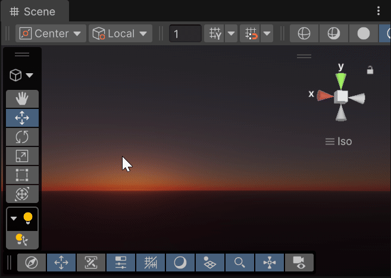
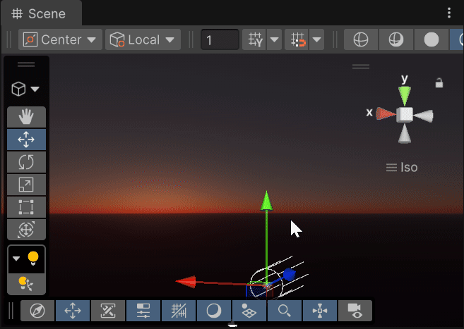

# Production Ready Atmosphere Rendering
This implements Unreal Engine's skybox in Unity from Sébastien Hillaire's paper.

 

## How to use
- The sample scene is already set so that the background is rendered using this method. No need to hit play.
- The main script is called AtmosphereRenderer.cs, there is a game object with the same name in the demo running it. It receives a scriptable object containing the parameters for the atmosphere. 
- Attaching an AtmosphereParameters scriptable object to the renderer or changing the values of a currently attached one will immediately update the render.
- You can create new parameters by right clicking the project window and going Create -> Data -> Lighting -> AtmosphereParameters.

## Missing Features and Issues
- This does not implement the aerial view LUT. 
- Going off the planet's atmosphere radius breaks the rendering. This can be fixed by adjusting the raymarching to account for the camera being outside the planet. 
- Only considers one light source.
- Tone mapping and gamma correction is being done before the LUT gets upscaled. This helped a bit
in performance, but doing it at the fragment shader should yield better visuals. 

## References
- https://sebh.github.io/publications/egsr2020.pdf
- https://www.shadertoy.com/view/slSXRW# <- Special thanks to Andrew Helmer for sharing this.
- https://www.shadertoy.com/view/fd2fWc# <- Potential fix for Aerial view
